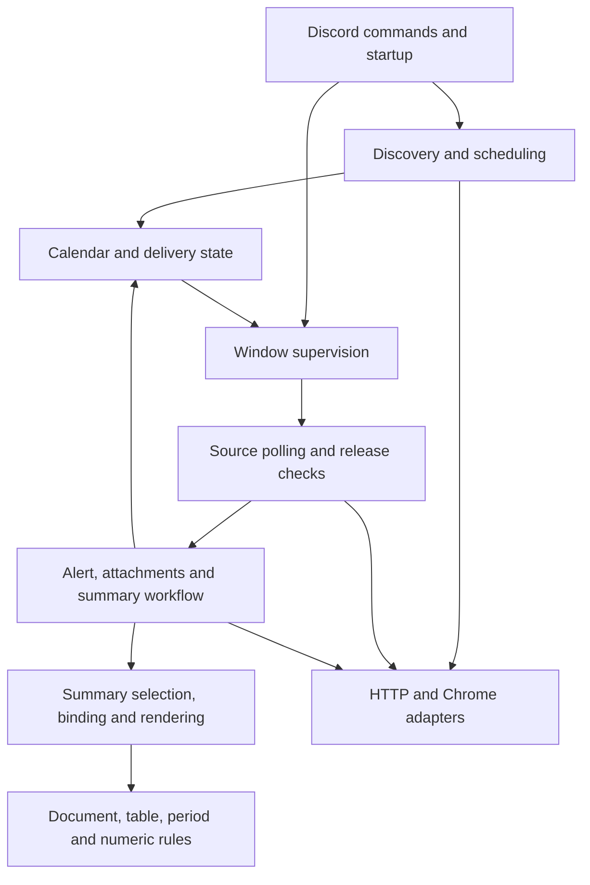
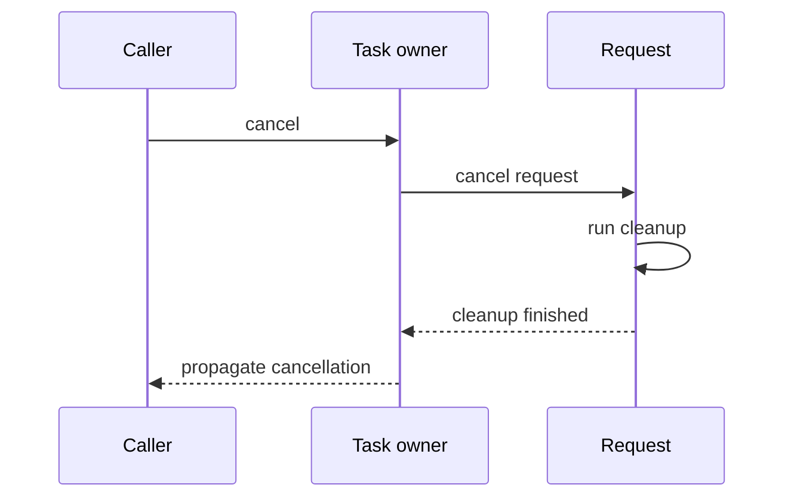

# Python quality guide

How this project's Python is written and structured: the conventions and their sources,
module structure and ownership, and resource lifetimes. Passing the linters is one input,
not the whole standard.

## Conventions and their sources

These are project decisions informed by the references below. Python does not prescribe
one application architecture, a maximum function length, or a target comment percentage.

| Area | Convention for this project | Reference |
|---|---|---|
| Readability | Keep the configured 100-character format. Use descriptive names, straightforward control flow and small cohesive operations. Shorten code when that improves comprehension. | [PEP 8](https://peps.python.org/pep-0008/), [PEP 20](https://peps.python.org/pep-0020/) |
| Comments | Delete narration of visible operations and stale development notes. Keep reasons, external constraints, units and invariants. Move long incident accounts to linked docs. Rename confusing code before adding explanatory narration. | [PEP 8 comments](https://peps.python.org/pep-0008/#comments) |
| Docstrings | Explain a module's responsibility and the contract of meaningful public operations: inputs, result, side effects, errors and ownership where relevant. Avoid repeating the signature in prose. | [PEP 257](https://peps.python.org/pep-0257/) |
| Structure | Keep `src/first_print`, `tests`, `scripts`, `docs` and `pyproject.toml`. Group modules when they share a responsibility and a clear interface. | [PyPA layout discussion](https://packaging.python.org/en/latest/discussions/src-layout-vs-flat-layout/) |
| Types | Describe internal data precisely; validate untrusted data at entry. Use `Any` deliberately at JSON/SDK boundaries. Prefer a small named record or protocol when it clarifies an actual contract. | [Python typing](https://docs.python.org/3.13/library/typing.html), [typing best practices](https://typing.python.org/en/latest/reference/best_practices.html) |
| Async ownership | Give every task an owner, observe failures and finish cleanup. Propagate cancellation after cleanup. Use a task group for related tasks with a shared lifetime when its failure behavior fits. | [Python 3.13 asyncio](https://docs.python.org/3.13/library/asyncio-task.html#task-cancellation) |
| Resources | Make the lifetime of clients, files, connections and Chrome processes explicit. A SQLite transaction context does not close the connection. | [SQLite contexts](https://docs.python.org/3.13/library/sqlite3.html#how-to-use-the-connection-context-manager) |
| Failure reporting | Give recoverable failures an observable outcome. Catch broadly at a deliberate isolation boundary, with logging, a recorded error or a documented fallback. | [Logging HOWTO](https://docs.python.org/3.13/howto/logging.html) |
| Tool exceptions | Keep type/lint suppressions specific and justified. Remove obsolete suppressions; Ruff already enables the relevant unused-`noqa` check. | [Ruff RUF100](https://docs.astral.sh/ruff/rules/unused-noqa/) |

Use the existing vocabulary consistently: an issuer, release, source, watch, window, sighting
and delivery represent different things. Name durations with their units and distinguish
monotonic elapsed time from timezone-aware publication time.

An abstraction should make an existing responsibility easier to locate and test. A helper
used once can clarify a substantial phase; a generic framework for hypothetical future
sources needs a demonstrated benefit. Keep policy decisions visible at the workflow level.

### Published code worth studying

These are concrete examples, pinned to releases rather than moving branches:

- [HTTPX 0.28.1 transport interface](https://github.com/encode/httpx/blob/0.28.1/httpx/_transports/base.py):
  a small transport boundary and explicit resource lifetime. Apply that idea to the bot's
  HTTP/Chrome boundary; there is no need to switch HTTP libraries to learn from it.
- [Click 8.1.8 package interface](https://github.com/pallets/click/blob/8.1.8/src/click/__init__.py)
  and [project configuration](https://github.com/pallets/click/blob/8.1.8/pyproject.toml):
  explicit exports, separate implementation modules, `src` packaging and warnings-as-errors.

Borrow the relevant design decisions. These projects also have different compatibility
requirements and large modules; their directory trees are examples, not universal rules.

## Structure and ownership

The current root layout is appropriate:

```text
first-print/
  pyproject.toml             package, dependencies and tool settings
  src/first_print/          application and its domain-specific modules
  tests/                    behavioral tests, shared fakes, fixtures and replays
  scripts/                  maintenance, evaluation and Windows operations
  docs/                     architecture and operator guidance
  .context/                 ignored research, reviews and dated evidence
  schedules/                declarative watch and trial plans
  .github/workflows/        CI, image builds and scheduled checks
```

This diagram groups existing responsibilities. The boxes are conceptual areas, not a claim
that these subpackages already exist. Arrows show calls or use of data.



Prefer extracting a cohesive responsibility before moving folders. For example, date
interpretation can be separated from scheduling and cache preparation without changing
all imports at once. A `summaries/` package may eventually make that family easier to
navigate. Keep compatibility imports where callers need them.
Avoid a growing catch-all `utils.py` or a one-class-per-file policy.

### Reading the application

Start with the workflow whose behavior is changing, then follow its data and resource owners.
The [architecture overview](architecture.md#overview) shows how the workflows connect.

| Responsibility | Entry points and supporting modules |
|---|---|
| Startup and commands | `__main__`, `bot`, `commands`, `calendar`, `track_progress` |
| Plans and issuer research | `date_discovery`, `investigate`, `ir_pages`, `ir_research`, `newsroom_discovery`, `known` |
| Watch supervision | `unattended`, `recorder`, `release_band`, `publication_trials` |
| Source adapters | `sources`, `browser_sources`, `issuer_news`, `sec_results`, `quarterly_table`, `newsrooms` |
| Transport and cleanup | `fetch`, `browser`, `_windows_desktop`, `file_downloads`, `task_lifetime` |
| Delivery and recovery | `pipeline` (`Poster`, `Release`, `Releases`), `delivery`, `release_cards`, `edit_priority` |
| Summary selection and input | `summary_request`, `summary_policy`, `driver_profile`, `driver_profiles`, `summary` |
| Verification and display | `source_document`, `summary_verify`, `summary_binding`, `binding_text`, `summary_format`, `summary_duplicates` |
| Estimate provenance | `consensus_prefetch` fetches before windows; `consensus` validates period, basis, currency and cutoff |
| Observations | `source_audit`, `publisher_history`, `issuer_history`, `benchmark`, `transition_evidence`, `resources` |

`DateDiscovery._check` coordinates research, bounded route preparation and plan commit.
`_find_date` defines evidence precedence; `_missing_date` explains an unresolved date.
The coordinator retains the busy, deadline and stale-row checks around asynchronous work.

`pipeline` keeps Discord transport implementations next to release orchestration. `Poster`
is the interface between them; shared downloads belong to the release, not any one server.
The verifier separates candidates, source documents, binding, policy and rendering. Keep rule
order and fail-closed evidence checks visible when changing those modules.

### Runtime owners

| Work or resource | Owner and completion |
|---|---|
| Watcher and summary client | `EarningsBot` drains its watcher before Discord closes; `_watch` closes its summarizer in `finally` |
| Window and research tasks | `DirectoryWatcher.run` cancels and gathers windows, trials and date discovery; `watch_directory` drains its auxiliary tasks |
| Shared polling | Each `SharedPoll` member owns its deadline; the last member cancels and drains the polling worker |
| Headline reads | `Releases` observes failures and cancels and gathers outstanding reads when the target or watcher finishes |
| Host pacing | `Fetcher` cancels queued turns and drains dispatchers before closing the HTTP session |
| Chrome | The fetcher holds leases for research and active reads; idle scans close only when there are no holders |
| Downloads and release steps | `Release` retains tasks; `FileDownloads` shares successful bytes and drains workers at release completion |
| Scorecard request | `EditPriority.card` retains the request through cancellation cleanup; release work can preempt it |
| Response evidence | `TransitionEvidence` retains its writer; `flush` awaits it and surfaces writer failure |
| SQLite | The enclosing watcher/store scope closes connections; transaction contexts only commit or roll back |

### Resource lifetime to verify

For a request owned by a caller, cancellation should leave a known owner until cleanup ends.
If cleanup intentionally outlives the caller, a longer-lived supervisor must retain it.



Shared downloads have a different lifetime: cancelling one reader must preserve work another
reader needs. Their owner still has to drain the worker when the release finishes.
